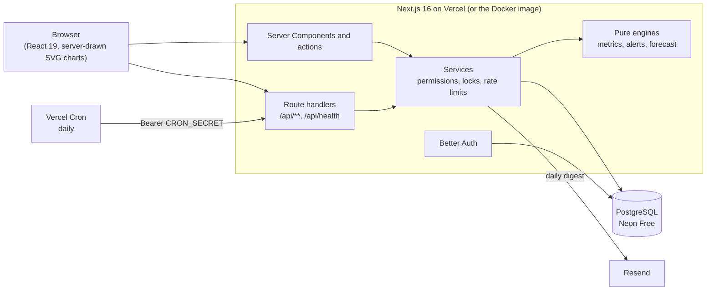

# TaskFlow

[](https://github.com/IgnisCreator/Taskflow/actions/workflows/ci.yml)

A ClickUp-style task tool built around **Kanban flow**: workspaces with spaces, folders and lists, a board whose workflow you configure per list, and the metrics that tell you whether work is actually flowing (cycle time, throughput, WIP, cumulative flow, and a Monte Carlo forecast).

It is a portfolio project: a demo, not a product. It runs entirely on free tiers (Vercel Hobby, Neon Free, Resend Free, GitHub Actions).

## Overview

- **Hierarchy and permissions.** Workspace > Space > Folder > List. Roles `OWNER`, `ADMIN`, `MEMBER` and `GUEST`; private spaces are visible only to the people who were added to them.
- **Configurable workflows.** Each list has its own stages (with categories such as to do, doing, done), WIP limits, templates, and a default workflow per space.
- **Tasks.** Board and table views, filters and sorting, several assignees, types, labels, checklists, comments, blocking with a reason, and an append-only history of every change.
- **Flow metrics.** Per list or per space: cycle time and lead time with percentiles, throughput, WIP, aging, and a cumulative flow diagram. Every chart comes with a sentence stating what it shows, the data table behind it, and an explanation citing its source.
- **Alerts.** WIP over its limit for several days, a widening cycle-time band, a task older than the 85th percentile, a drop in throughput. In-app notifications, plus an opt-in daily email.
- **Forecast.** "When will it be done?" and "How many by this date?" answered by a seeded Monte Carlo simulation of your own history (10,000 runs). The seed and the history window are always shown, so a result can be reproduced.
- **Public demo.** "Explore the demo" signs a read-only visitor into a sample workspace made from a seeded 180-day simulation with a bottleneck in code review. A daily job renews it.

## Architecture



Pages and route handlers call services; services own permission checks, locking and the database (Prisma 7 with the `pg` adapter). The metrics, alerts and forecast engines are pure functions over task events, so they are tested without a database. Charts are drawn on the server as SVG, so they need no client JavaScript.

## Technical decisions

The detailed decision records are kept outside the repository; the ones that shape the code:

- **Append-only `TaskEvent`.** Every move, assignment and edit is an event; metrics are computed from events, never from the task's current state, so they stay correct when a workflow is edited.
- **PostgreSQL does the coordination.** Per-list and per-workspace advisory locks serialize concurrent edits; the alerts job and the demo regeneration take an advisory lock too; rate limits are rows in the database. No Redis, nothing else to host.
- **Pure engines, tested hard.** Percentiles are nearest-rank, days are UTC, the forecast uses a seeded generator (mulberry32) so tests assert exact numbers.
- **Better Auth** for sessions, with email and password. GitHub login exists for development only.
- **Closed by default.** Production runs with no public sign-up and no GitHub login; accounts are created by script (`npm run user:create`). `OPEN_ACCESS=1` opens the doors for development and tests.
- **A demo that cannot hurt.** The visitor is a `GUEST` with a derived password, account-changing endpoints refuse demo sessions, and regeneration deletes only the workspace flagged `isDemo`.
- **Basic security headers, no strict CSP yet.** A strict Content-Security-Policy needs per-request nonces; it is recorded as debt rather than shipped half-working.
- **Design tokens.** Tailwind with semantic colour tokens; a source guard rejects raw colours.

## Requirements

- Node.js 24 (`.nvmrc`)
- npm
- Docker with Compose

## Getting started

```bash
cp .env.example .env         # then fill in the values (see below)
npm ci
docker compose up -d --wait  # PostgreSQL, ready when its healthcheck passes
npm run db:migrate           # applies the migrations explicitly
npm run dev                  # http://localhost:3000
```

Keep `OPEN_ACCESS=1` in your `.env` for development; without it the app behaves like production (no sign-up, no GitHub login). Then either sign up with email, or create an account with the script:

```bash
USER_PASSWORD='a-long-password' npm run user:create -- --email you@example.com --name You
```

### GitHub OAuth app (development)

1. GitHub > Settings > Developer settings > OAuth Apps > New OAuth App.
2. Homepage URL `http://localhost:3000`; Authorization callback URL `http://localhost:3000/api/auth/callback/github`.
3. Put the client ID and a generated client secret in `.env` as `AUTH_GITHUB_ID` and `AUTH_GITHUB_SECRET`, and a random `BETTER_AUTH_SECRET` (32+ characters). Never commit `.env`.

### The demo locally

Set `DEMO_ENABLED=1` and `CRON_SECRET=<random>` in `.env`, run `npm run alerts:run` once (it builds the sample workspace), and use "Explore the demo" on the landing page.

## Environment variables

| Variable                               | Needed                | Purpose                                                                                    |
| -------------------------------------- | --------------------- | ------------------------------------------------------------------------------------------ |
| `DATABASE_URL`                         | always                | PostgreSQL connection URL used by the app (a pooled URL is fine)                           |
| `DIRECT_URL`                           | optional              | Direct (non-pooled) URL used only by migrations; falls back to `DATABASE_URL`              |
| `BETTER_AUTH_SECRET`                   | always                | 32+ random characters; signs sessions                                                      |
| `APP_URL`                              | production            | Public base URL of the deployment (defaults to `http://localhost:3000`)                    |
| `OPEN_ACCESS`                          | development           | `1` opens sign-up and GitHub login. Leave unset in production                              |
| `AUTH_GITHUB_ID`, `AUTH_GITHUB_SECRET` | development, optional | GitHub login; set both or neither                                                          |
| `CRON_SECRET`                          | production            | Bearer secret of the daily job. Without it `/api/cron/alerts` answers 503 and does nothing |
| `DEMO_ENABLED`                         | optional              | `1` shows "Explore the demo" and lets the daily job renew the sample workspace             |
| `RESEND_API_KEY`, `EMAIL_FROM`         | optional              | Email delivery. Without a key, links and digests are logged to the server console          |

## Deployment (Vercel + Neon + Resend)

Everything below is free-tier. Nothing here needs a credit card except, optionally, a domain.

1. **Neon.** Create a project and a database. Copy the pooled connection string (for `DATABASE_URL`) and the direct one (for `DIRECT_URL`).
2. **Vercel.** Import the GitHub repository. `vercel.json` already sets the build command and the daily cron. Add the environment variables for **Production**: `DATABASE_URL`, `DIRECT_URL`, `BETTER_AUTH_SECRET`, `APP_URL` (the project's public URL), `CRON_SECRET` (Vercel Cron sends it as a Bearer token), and `DEMO_ENABLED=1` if you want the demo. Do not set `OPEN_ACCESS`.
3. **Deploy.** `npm run vercel-build` applies the migrations (`prisma migrate deploy`) on production deployments only, then builds. Preview deployments do not touch the database.
4. **First account.** There is no sign-up in production. Create the owner from your machine against the production database:
   ```bash
   DATABASE_URL='<direct url>' USER_PASSWORD='<long password>' npm run user:create -- --email you@example.com --name You
   ```
5. **Check it.** `GET /api/health` should answer `{"status":"ok"}`. Trigger the daily job once so the demo exists: `curl -H "Authorization: Bearer $CRON_SECRET" https://<your-app>/api/cron/alerts`.
6. **Email (optional).** Resend's free plan only delivers to other addresses from a domain you have verified. Add `RESEND_API_KEY` and `EMAIL_FROM` once you have one; until then the daily digest and verification links are only logged.

Hobby plans run cron jobs once a day, which is all the app needs.

### Docker

The same app as a container, for any host that runs Docker:

```bash
docker build -t taskflow .
docker build --target migrate -t taskflow-migrate .
docker run --rm -e DATABASE_URL="<url>" taskflow-migrate       # release step: applies the migrations
docker run -d -p 3000:3000 --env-file .env.production taskflow # serves on :3000, non-root, with a healthcheck
```

The runtime image holds only the standalone Next.js build (about 400 MB); the `migrate` target carries the Prisma CLI and the scripts (`user:create` runs from it).

## Scripts

| Command                | Purpose                                                                                                 |
| ---------------------- | ------------------------------------------------------------------------------------------------------- |
| `npm run lint`         | ESLint                                                                                                  |
| `npm run format:check` | Prettier check                                                                                          |
| `npm run typecheck`    | TypeScript (no emit)                                                                                    |
| `npm test`             | Unit and integration tests (Vitest); needs PostgreSQL running and migrated                              |
| `npm run db:validate`  | Validate the Prisma schema                                                                              |
| `npm run build`        | Production build                                                                                        |
| `npm run test:e2e`     | Browser tests (Playwright); needs a build and PostgreSQL. First time: `npx playwright install chromium` |
| `npm run alerts:run`   | Run the daily job once, locally                                                                         |
| `npm run user:create`  | Create an account (password from `USER_PASSWORD`)                                                       |

### Checks in Docker

The same pipeline as CI runs in containers (Playwright 1.64.0 image with Node 24), so nothing but Docker is needed:

```bash
docker compose run --rm check             # clean clone of the current branch: lint, types, tests, build, E2E
docker compose run --rm check my-branch   # any local branch
docker compose run --rm tools npm ci      # once: install Linux packages for the working-tree container
docker compose run --rm tools node scripts/create-db.mjs
docker compose run --rm tools sh -c "npm run db:migrate && npm test"
```

They use throwaway databases (`taskflow_ci`, `taskflow_test`); `scripts/create-db.mjs` refuses any other name.

CI runs the same steps on every pull request and on `main`, and reports `npm audit` as a non-blocking step.

## How AI tools were used

TaskFlow was built with Claude Code (Anthropic) as the main pair-programming tool, working milestone by milestone: the owner set the requirements and the design decisions, the assistant wrote most of the code and tests, and each milestone was validated by the full pipeline in a clean clone before it was merged. The README was drafted by the assistant and reviewed by the owner. The repository vouches for its behaviour through its tests, not through who wrote the code: 880+ unit and integration tests and 60+ browser tests.

## Limitations

- A demo, not a product: single region, free-tier limits, no uptime promise.
- Production is closed: no sign-up and no password reset flow, and no per-account lockout beyond the rate limits.
- Email reaches other people only from a verified domain; without one it is evidence in the logs.
- The interface is in English only, with its strings still inline in the components.
- No strict Content-Security-Policy yet, and no screen-reader audit beyond the accessibility basics (labels, roles, tables behind every chart).
- Not built yet: editing comments, reordering subtasks, a forecast per space, collapsing the Done column.
